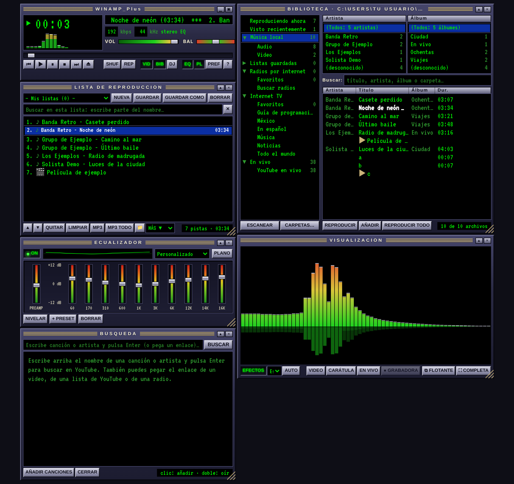

# RetroAmp 🎵

Reproductor **retro, inspirado en el Winamp clásico**, para Windows: música, videos y transmisiones en vivo de YouTube, la música de tu PC, consola DJ, skins clásicos y más.



## 📥 Descargar

| Archivo | Para qué |
|---|---|
| 👉 [**RetroAmp-1.3-Instalador.zip**](https://github.com/ElarCastro/RetroAmp/releases/download/v1.3/RetroAmp-1.3-Instalador.zip) | Instalador con accesos directos. Actualiza RetroAmp 1.1 o 1.2 sin perder tus listas. |
| [RetroAmp-1.3-portable.zip](https://github.com/ElarCastro/RetroAmp/releases/download/v1.3/RetroAmp-1.3-portable.zip) | Sin instalar: descomprime y abre `RetroAmp.exe`. Sirve en una USB. |
| [SHA256SUMS.txt](https://github.com/ElarCastro/RetroAmp/releases/download/v1.3/SHA256SUMS.txt) | Firmas para comprobar que la descarga está completa y no fue alterada. |

Todas las versiones están en [Releases](https://github.com/ElarCastro/RetroAmp/releases).

1. Descarga el instalador y descomprímelo.
2. Ejecuta `RetroAmp-1.3-Setup.exe`. No pide permisos de administrador.
3. Si Windows muestra *"Windows protegió su PC"*, pulsa **Más información → Ejecutar de todas formas**. El programa no tiene firma digital de pago.

**Requisitos:** Windows 10 u 11, de 64 bits.

### Comprobar la descarga (opcional)

En PowerShell, dentro de la carpeta donde descargaste el archivo:

```powershell
Get-FileHash .\RetroAmp-1.3-Instalador.zip -Algorithm SHA256
```

El resultado debe coincidir con la línea correspondiente de `SHA256SUMS.txt`.

## 🆕 Novedades de la versión 1.3

- **Solo YouTube**: RetroAmp reproduce videos, música y transmisiones en vivo de YouTube, además de tu música de la PC. Se quitaron los canales de TV por internet (IPTV), las radios por internet y las páginas de TV en vivo. Si tenías alguno en tus listas, se quita solo al abrir.
- Si se abre por error el paquete `actualizacion` (que solo usa el actualizador interno), RetroAmp avisa en vez de abrirse a medias en el navegador.
- **Skins más nítidos y sin marcas**: se amplían a píxel exacto según la escala de la pantalla (antes se veían borrosos con Windows al 125 %). Vienen 4 skins sin la palabra WINAMP ni marcas de otros (Amstrad, Axonamp, DOSamp y Black & White); se puede seguir agregando cualquier `.wsz`.
- **Ícono arreglado**: la 1.2 borraba su propio ícono al abrirse y los accesos directos (y el fijado en la barra de tareas) se veían como una hoja en blanco.
- Si tienes la 1.2, el aviso de versión nueva te ofrece **actualizar con un clic**.

## Novedades de la versión 1.2

- **Lo mejor de WINAMP_Plus 2.17 dentro de RetroAmp**: video y películas con subtítulos, YouTube en vivo (con imagen o solo audio) y su grabadora, consola DJ, skins clásicos (.wsz), importar listas de Spotify, biblioteca y preferencias con árbol de secciones.
- **Actualizaciones más seguras**: el programa busca versiones nuevas en este repositorio y **comprueba la firma SHA-256** antes de instalarlas. El cambio de archivos lo hace el propio `RetroAmp.exe`, **sin scripts `.cmd` ni PowerShell ocultos**.
- **Menos falsas alarmas de antivirus**: ya no borra la marca "descargado de internet" de sus archivos, y el `.exe` lleva sus datos de autor y versión.
- **Iniciar con Windows** abre RetroAmp minimizado, como en la 1.1.
- Si lo instalas encima de RetroAmp 1.1, WINAMP_Plus o WinampYT, **conserva tus listas, ajustes y descargas**.

## ✨ Funciones principales

- **Ventana propia** del tamaño del reproductor, con ventanas sueltas e imanes (ecualizador, lista, biblioteca, visualización…).
- **👻 Modo fantasma**: queda encima de todo, semitransparente, y el mouse lo atraviesa. Mantén **Ctrl** o **Alt** para tocarlo; **Ctrl+Alt+F** lo activa o desactiva desde cualquier programa.
- **Mini reproductor**, botones ⏮ ▶ ⏭ en la miniatura de la barra de tareas y **teclas multimedia**.
- **Ecualizador de 10 bandas**, temas y **skins clásicos** con vista previa.
- **Descargas a MP3 y MP4** con carátula y nombre "Artista - Canción".
- **Todo lo tuyo en la carpeta `media`** (música, videos, listas, grabaciones y ajustes), para respaldarlo o pasarlo a otra PC.

El manual completo con imágenes viene en `ManualUsuario.pdf`, y dentro del programa con el botón **?** (o **F1**).

## 🛠️ Cómo está hecho

- **Interfaz:** HTML/CSS/JS (`RetroAmp.html`), mostrada con Microsoft WebView2.
- **Motor:** C# compilado en `RetroAmp.exe`. Atiende la interfaz solo en `127.0.0.1`, protegido con una clave aleatoria por sesión.
- **Herramientas:** [yt-dlp](https://github.com/yt-dlp/yt-dlp) + [Deno](https://deno.com) para YouTube, [FFmpeg](https://ffmpeg.org) para MP3/MP4 y grabaciones, [hls.js](https://github.com/video-dev/hls.js) para YouTube en vivo.
- **Instalador:** NSIS (`instalador/RetroAmp.nsi`).

### Compilar

1. Copia `yt-dlp.exe`, `deno.exe`, `ffmpeg.exe` y `ffprobe.exe` en la carpeta `bin\`.
2. Ejecuta `compilar.bat` (usa el compilador de C# que ya trae Windows). Genera `build\RetroAmp` (la versión portable).
3. Instalador: con [NSIS 3](https://nsis.sourceforge.io), `makensis instalador\RetroAmp.nsi`.

### Publicar una versión nueva

Para que el aviso de actualización de RetroAmp la encuentre, el Release debe tener:

- Una etiqueta con el número de versión, por ejemplo `v1.3`, y la misma versión en `AssemblyVersion` (`Program.cs`).
- `RetroAmp-X.Y-portable.zip` (completo) y, recomendado, `RetroAmp-X.Y-actualizacion.zip` (solo el programa, sin `datos\bin`).
- `SHA256SUMS.txt` con la firma de cada archivo (`sha256sum *.zip > SHA256SUMS.txt`). **Sin este archivo, RetroAmp no instala la actualización.**

## 🙌 Créditos

- Basado en *WinampYT* / *WINAMP_Plus*, un proyecto que descargué y fui mejorando.
- Mejorado y empaquetado con la ayuda de **Claude (Anthropic)**.
- yt-dlp, Deno, FFmpeg, hls.js (Apache 2.0), WebView2 y la fuente VT323 (OFL) pertenecen a sus respectivos autores. Los skins clásicos incluidos (Amstrad, Axonamp, DOSamp y Black & White) son de sus autores originales.

## ⚠️ Aviso

Proyecto personal y sin fines de lucro. **No está afiliado a Winamp** (marca de sus respectivos dueños) **ni a YouTube/Google ni a Spotify**; "inspirado en Winamp" solo describe su estilo visual. Úsalo respetando los términos de servicio de YouTube y los derechos de autor de la música.
